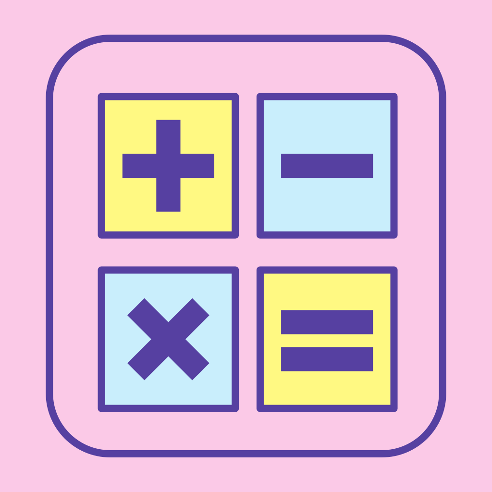
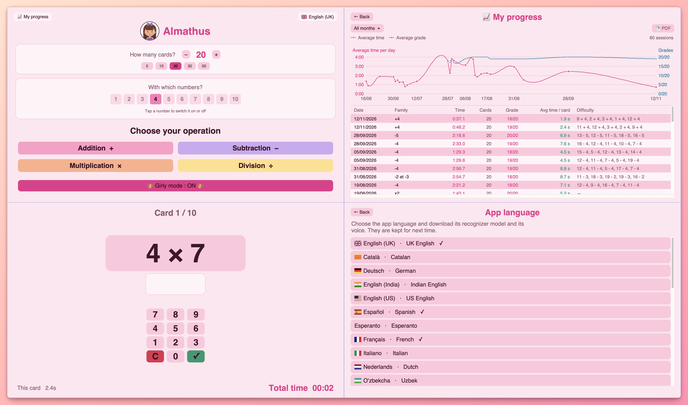
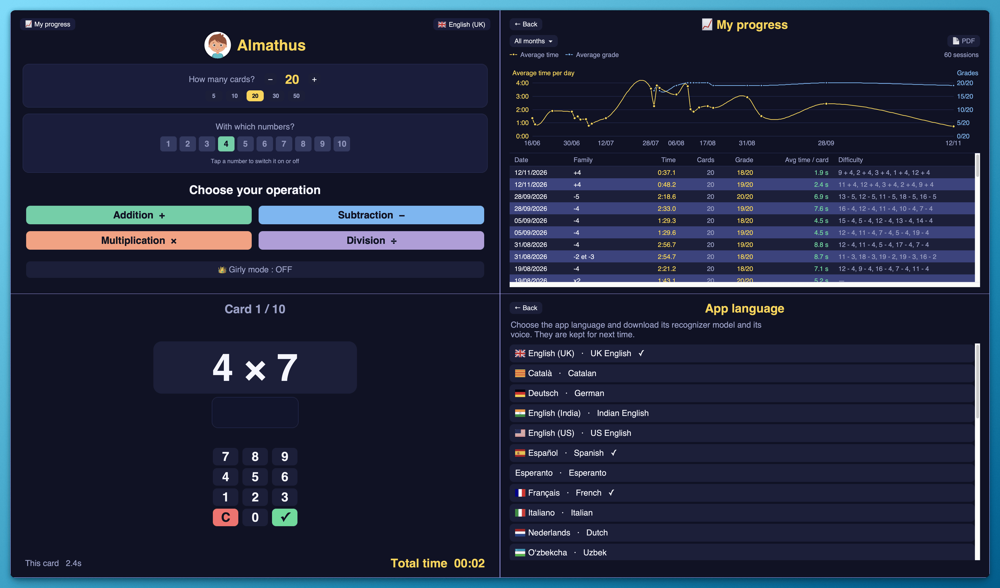

# 🧮 Almathus

Anki-like flashcard app that teaches basic maths to children 😉.

The exercises are the same ones speech and language therapists give to help children build
automatic recall of basic operations.

The game is aimed at children aged 6 to 8,
and for now covers addition, subtraction, multiplication and division. Harder
levels will be added later.

Each game is a deck of two-number cards: the child gets one card at a time,
answers it, and the next one comes up. A stopwatch times every answer and the
whole game. The faster the answer, the better.

Parents can organize daily sessions with their child, follow progress made overtime with detailed reporting.

The interesting part of this MVP is the voice loop: TTS reads the question aloud,
STT takes the answer, and the game validates it. The keyboard and the on-screen
keypad also work, but the aim was to keep the child's hands off the pad to solely focus on the solving part without distractions.

Built with Python and Tkinter, and no third-party packages: the base game runs on
the standard library alone. The voice features are optional (`--extra voice`).
Speech recognition runs on Vosk models, one per language and downloaded on first
use; speech out runs on Piper, in a separate process. On Linux, a system Python may
still need `python3-tk` for Tk itself.

## Screenshots

Two theme skins: light and dark modes.

**Light A.K.A "Princess" mode**



**Dark A.K.A "Prince" Mode (the default palette)**



## Run

```bash
uv run almathus
# or
uv run python main.py
# or, without uv:
python3 main.py
```

## How It Plays

1. **Set up the game.** Choose how many cards to put in the deck (20 by default),
   then pick one operation: addition, subtraction, multiplication or division.
2. **Wait for the countdown.** 3, 2, 1, go.
3. **Answer each card.** The operation is shown in big numbers (`8 − 2`). Tap the
   numbers on the on-screen keypad, type them and press Enter, or just say the
   answer out loud.
4. **Expect a second pass.** Every card missed on the first try comes back once at
   the end. 🔁
5. **Read the recap.** Score, total and average time, and the five slowest
   operations, the ones worth practising tomorrow.

## Progress Screen

My progress, accessible from the top left of the settings screen or on the recap
after a game, shows:

- **Average session time.** On the left-hand axis, one point per day on a real
  calendar timeline.
- **Grades.** On the right-hand axis, out of the deck the child plays most. A
  day with no session leaves a gap in that line.
- **A date filter.** All months, or any one month from the list.
- **Every session.** Newest first: its grade, its average time per card, and the
  five cards it fought with.
- **A PDF.** Same chart, same table, in the colors on your screen.

## What It Records

A game is timed twice over: the current card (bottom-left) and the session as a
whole (bottom-right). When the game ends, the session is saved twice, in
**`Documents/Almathus/`** or wherever `ALMATHUS_RESULTS_DIR` points:

| File | What's in it |
|---|---|
| `results.csv` | one line per session. This is the one you can edit by hand, and the one the progress screen reads |
| `stats/<timestamp>-<mode>.json` | everything about every card: time, attempts, whether it was right first time |

## The Results Log: `results.csv`

The app's database: one line per session, plus the columns the progress screen
reads. Every finished session lands at the bottom, and whatever you edit by hand
is what the app believes next time. It only ever appends. The one thing it will
touch is the header, which gains a column when your file is missing one the app
knows about.

### Header

```csv
date,family,time,cards,grade,average_time_per_card,difficulty
2026-06-16,-1,0:31,,,,
2026-07-28,-2 and -3,1:35.4,20,18,4.8,"17 - 4, 13 - 4, 9 - 4, 6 - 4, 20 - 4"
```

| Header | Meaning |
|---|---|
| `date` | day the session was played |
| `family` | which family was drilled: `-3`, `-2 and -3`, `x7` |
| `time` | total time of the session |
| `cards` | how many cards were asked |
| `grade` | cards right on the first try |
| `average_time_per_card` | `time / cards` |
| `difficulty` | the five cards that session fought with |

The app writes the header in whatever language it is running in, so a French
install writes the same seven columns in French, and **both are read** in any
column order. Matching ignores case, accents, spaces and underscores (`Temps`,
`Average time per card` and `temps_moyen` all work), and a few synonyms are
accepted, listed in `ALIASES` (`results.py`). Columns the app does not know are
left untouched when it appends.

### Editing It by Hand

| Column | What you can write |
|---|---|
| **date** | `2026-06-16`, `16/06/2026`, `16/06/26`, `16-06-2026`, `16.06.2026`, `2026/06/16`, or short `16/06` · `16-06` · `16.06`. **Empty repeats the row above.** |
| **family** | free text. The app writes the operator sign then the numbers switched on: `-3`, `-2 and -3`, `x7`, `+1–10`. ASCII signs (`+ - x /`) so the column stays easy to type. |
| **time** | `1:23` · `1:23.4` · `1'23` · `1'23"4` · `83"` · `83` · `83.4` · `1,23`. A comma followed by exactly two digits below 60 is the minute separator (`1,29` = 1 min 29 s); otherwise it is a decimal point (`32,60` = 32.6 s). **Use a dot for a decimal.** |
| **cards** | an integer, or empty when unknown. |
| **grade** | cards right on the first try, as a bare number (`15`); the denominator is the `cards` cell beside it. Typing `15/20` keeps only the numerator. |
| **average time per card** | plain seconds. Empty means it is computed as `time / cards`. |
| **difficulty** | the hardest cards, hardest first: `18 - 4, 11 - 4, 13 - 4`. **The next session reads this cell back**, so writing a card in is a way to say *drill this tomorrow*. |

Rows that can't be read are skipped, never rewritten. A fresh install starts with
the header line and no rows.

### Difficult Cards Saved for Revision

- **What makes a card difficult.** A wrong answer, or a slow one. The session
  ranks its cards, wrong first, then the slowest. The top five go into the
  `difficulty` column, so you can focus on the operations the child struggled
  with most.
- **Both sittings count.** A card missed on the first pass comes back at the end,
  and the two times are added, so a quick fumble keeps the time it really cost.
- **Every listed card comes back twice**, the copies kept apart in the shuffle.
  Back to back, the second would only test the memory of the first.
- **Only what the round can ask.** It reads the last day played, all of that
  day's sessions together, and deals the same operation from a number that is
  still switched on. Switch from *−4* to *×2* and the *−4* cards wait.
- **Never more than half the deck.** Five carried-over cards need a deck of
  twenty.
- **The average here is the whole session.** The recap averages thinking time per
  card; this column divides the whole session, pauses and retry round included,
  by the card count, so it matches the columns beside it.

## Configuration

| What | Where |
|---|---|
| Number ranges | `RANGES` in `main.py`: addition and subtraction use operands **0–20** (never negative); multiplication and division use factors **0–10** (division always divides evenly) |
| Number words | generated from `num2words`, except Chinese, Hindi, Gujarati, Georgian, Kyrgyz and Uzbek, written out in `_TABLE_NUMBERS` (`voice.py`) |
| Language | chosen in the app (*App language* on the settings screen, or the chip in the top-right corner) and remembered in `prefs.json`; `DEFAULT_LANG` in `main.py` only decides what an install starts on |
| Remembered choices | `prefs.json`: language, dictation, theme, number selection |
| Results folder | `ALMATHUS_RESULTS_DIR` |

---

# Technical Details

## Voice

`voice.py`: speech out and speech in, each a no-op when its dependencies are
missing. The keypad always works.

### Speech Out

**Piper**, one model per language (63–128 MB), downloaded at setup. The game never
imports it: it runs `sidecar/piper_sidecar.py` and exchanges text and PCM over
stdin/stdout, which keeps the GPL engine out of the MIT app. Source runs need
`--extra sidecar`; packaged builds ship a frozen helper.

- The voice is a **file**, so a card sounds the same on a Mac and on a PC:
  nothing to enable, no language pack, nothing online.
- No Piper model for Esperanto, Gujarati, Kyrgyz, Tajik or Uzbek, and none until a
  download finishes: the OS voice takes over (`say`, `espeak-ng`, `pyttsx3`),
  picked from that language's adult voices, women first.
- `ALMATHUS_TTS_VOICE` picks another voice. `ALMATHUS_TTS_BACKEND` forces a
  backend: `say`, `espeak`, `pyttsx3` or `piper` (`auto` by default).

**French numbers are read the way a teacher says them.** *six*, *huit* and *dix*
keep their final consonant before an operator, and *plus* is /plys/ rather than
the /ply/ of conversation. The text is respelled before it is voiced (`dix` →
*disse*, `huit` → *huite*). French is the one language of the 23 measured where a
number loses a consonant in context.

### Dictation

Each card is read aloud before the child answers, on by default. The mic opens when
the reading ends and neither clock runs during it, so the log measures thinking
rather than speech. With dictation off, the mic and the clocks start with the card.

### Answer by Voice

Runs continuously beside the keypad. A spoken number is filled in and submitted;
the keypad stays usable throughout.

```
                    ┌── the room, measured ──┐
                    ▼                        ▼
mic audio ─▶ [VAD record] ─▶ [is it a voice?] ─▶ [subtract the room] ─▶ Vosk ─▶ [numbers only?] ─▶ submit
             (voice.py)       level + pitch       spectral subtraction     per-language  strict rule
```

Every stage can only say *not an answer*, and the card stays up:

- **The room is measured** at startup and kept current between answers. Thresholds
  are a factor over that measurement, so a bedroom and a terrace with a road both
  work, and a voice two meters back still clears the bar.
- **Recording** runs from the first speech to ~0.35s of silence, with a 6s cap: no
  button, no deadline on thinking.
- **Voicing** (the pitch of vocal folds) keeps chairs and coughs out of the
  recognizer. Level and signal-to-noise against the room are the whisper gate, so
  a murmur never scores a card; a voice too quiet gets *"🔊 Plus fort !"*.
  `uv run python mic_check.py` prints what your own mic measures.
- **The room's spectrum is subtracted** from the capture, gently (18 dB at most),
  and skipped when the room is already quiet.
- **Vosk recognizes it**, vocabulary limited to number words (~100 ms). One small
  model per language.
- **Numbers only**: every word must be a number, the all-numbers hypothesis must
  come within `ALMATHUS_VOICE_ALT_GAP` of the best, and a second un-constrained
  decode can veto it. One stray word and the utterance is refused.
- **A number that gets through is the answer**, as if ✓ had been pressed, right or
  wrong.

### Languages and Models

First run downloads that language's model into a per-user folder:
`~/Library/Application Support/Almathus` on macOS, `%LOCALAPPDATA%\Almathus` on
Windows, `~/.local/share/almathus` on Linux. `ALMATHUS_VOSK_MODEL` and
`ALMATHUS_MODELS_DIR` override the paths.

| Language | English | Model | Size |
|---|---|---|---|
| العربية | Arabic | `vosk-model-small-ar-0.3` | 104 MB |
| العربية (تونس) | Arabic (Tunisian) | `vosk-model-small-ar-tn-0.1-linto` | 166 MB |
| Català | Catalan | `vosk-model-small-ca-0.4` | 43 MB |
| 中文 | Chinese | `vosk-model-small-cn-0.22` | 44 MB |
| Čeština | Czech | `vosk-model-small-cs-0.4-rhasspy` | 46 MB |
| Nederlands | Dutch | `vosk-model-small-nl-0.22` | 40 MB |
| Esperanto | Esperanto | `vosk-model-small-eo-0.42` | 44 MB |
| فارسی | Farsi | `vosk-model-small-fa-0.42` | 53 MB |
| Français | French | `vosk-model-small-fr-0.22` | 42 MB |
| ქართული | Georgian | `vosk-model-small-ka-0.42` | 46 MB |
| Deutsch | German | `vosk-model-small-de-0.15` | 46 MB |
| ગુજરાતી | Gujarati | `vosk-model-small-gu-0.42` | 108 MB |
| हिन्दी | Hindi | `vosk-model-small-hi-0.22` | 44 MB |
| English (India) | Indian English | `vosk-model-small-en-in-0.4` | 38 MB |
| Italiano | Italian | `vosk-model-small-it-0.22` | 50 MB |
| 日本語 | Japanese | `vosk-model-small-ja-0.22` | 50 MB |
| Қазақша | Kazakh | `vosk-model-small-kz-0.42` | 60 MB |
| 한국어 | Korean | `vosk-model-small-ko-0.22` | 87 MB |
| Кыргызча | Kyrgyz | `vosk-model-small-ky-0.42` | 51 MB |
| Polski | Polish | `vosk-model-small-pl-0.22` | 53 MB |
| Português | Portuguese | `vosk-model-small-pt-0.3` | 32 MB |
| Русский | Russian | `vosk-model-small-ru-0.22` | 46 MB |
| Español | Spanish | `vosk-model-small-es-0.42` | 40 MB |
| Svenska | Swedish | `vosk-model-small-sv-rhasspy-0.15` | 304 MB |
| Тоҷикӣ | Tajik | `vosk-model-small-tg-0.22` | 52 MB |
| తెలుగు | Telugu | `vosk-model-small-te-0.42` | 61 MB |
| Türkçe | Turkish | `vosk-model-small-tr-0.3` | 37 MB |
| English (UK) | UK English | `vosk-model-small-en-gb-0.15` | 43 MB |
| Українська | Ukrainian | `vosk-model-small-uk-v3-small` | 144 MB |
| English (US) | US English | `vosk-model-small-en-us-0.15` | 41 MB |
| Oʻzbekcha | Uzbek | `vosk-model-small-uz-0.22` | 51 MB |
| Tiếng Việt | Vietnamese | `vosk-model-small-vn-0.4` | 34 MB |

All 32 answer by voice. Thirty take their number words from `num2words`; the six
it cannot spell (Chinese, Hindi, Gujarati, Georgian, Kyrgyz, Uzbek) are written out
in `voice.py`. Five have no Piper model (Esperanto, Gujarati, Kyrgyz, Tajik,
Uzbek) and speak through the OS voice.

**Tested on a real microphone: French and English (US, UK, India).** The other 27
are wired the same way and untested. Say which language you picked, what you said
and what happened if a number is misheard; `ALMATHUS_VOICE_DEBUG=1` prints the
recognizer's output to include.

### Tuning

Optional, with measured defaults:

| Variable | Default | What it does |
|---|---|---|
| `ALMATHUS_VOICE_ALT_GAP` | `0.5` | how far behind the best hypothesis an all-numbers one may score |
| `ALMATHUS_VOICE_VETO_CONF` | `0.9` | how sure the un-constrained model must be to overrule the number grammar |
| `ALMATHUS_VOICE_MIN_SNR` | `3.0` | how far a voice must stand above the room |
| `ALMATHUS_VOICE_MIN_VOICED` | `0.25` | fraction of frames that must carry vocal-fold pitch |
| `ALMATHUS_VOICE_LEVEL_OVER_ROOM` | `3.0` | how far over the measured room "out loud" is; raise it if noise scores cards |
| `ALMATHUS_VOICE_MIN_LEVEL_FLOOR` | `45` | never ask for less than this, so a silent room cannot leave the gate at nothing |
| `ALMATHUS_VOICE_MIN_LEVEL` | *(unset)* | a hard absolute gate; set it and nothing is measured |
| `ALMATHUS_VOICE_CALIB_SECS` | `1.5` | how long the startup listen to the room lasts |
| `ALMATHUS_VOICE_DENOISE` | `auto` | `1` always subtract the room, `0` never, `auto` when there is noise |
| `ALMATHUS_VOICE_DENOISE_ALPHA` | `1.5` | how hard to subtract it |

`voice.py` also reads `ALMATHUS_VOICE_NACF`, `..._ONSET_*`, `..._MIN_LEVEL_BLIND`
and `..._DENOISE_FLOOR` for rooms that defeat the above; leave those alone.

### Enabling It

```bash
uv sync --extra voice --extra sidecar --group dev
# voice   : sounddevice + numpy + num2words + vosk + webrtcvad (the mic)
# sidecar : piper-tts, the GPL engine the separate voice process runs
# keep --extra voice on every sync: without it uv prunes the audio libs and
# the mic goes dead
```

First run then asks for a language and downloads its model and voice.
**macOS needs microphone permission** for your terminal app, under *System
Settings → Privacy & Security → Microphone*.

### Debugging

`ALMATHUS_VOICE_DEBUG` is an environment variable; the app takes no arguments.
Set it and `voice.py` traces the pipeline to stderr, prefixed `[voice]`:

```bash
ALMATHUS_VOICE_DEBUG=1 uv run almathus
```

It reports capture setup, why a recording ended, the raw Vosk alternatives, why an
utterance was refused and any model load failure. Each capture is also copied to
`almathus_capture.wav` in the system temp folder.

### Tests

```bash
uv run python test_voice.py       # what counts as a spoken answer (no mic)
uv run python test_room.py        # the acoustic gates, against a synthesized room
uv run python test_game_flow.py   # a card leaves the screen only when answered
```

`test_room.py` checks that the bar moves with the noise and that a voice two
meters out in a quiet room is accepted. `test_game_flow.py` opens a Tk window and
stubs the mic: refused utterances may not move the card, a recognized number
scores at once, and both dictation modes open a card correctly.

## Licensing

- The game's code and its wheel are **MIT**, see [`LICENSE`](LICENSE).
- [`sidecar/`](sidecar/) is a separate **GPL-3.0** program; see
  [`sidecar/LICENSE`](sidecar/LICENSE). It owns Piper and espeak-ng so the game
  does not have to; an installer that bundles it is a GPL-3.0 combined work and
  must carry its source and license. The wheel never contains it.
- Voice models are downloaded at setup and keep their own licenses; the sounds
  are CC0 / CC BY ([`assets/README.md`](assets/README.md)); the flags are MIT.
- The app icon shown at the top (`assets/icon.svg`) is VistaCreate stock artwork:
  allowed inside the app, but its license does not clearly permit using it as a
  logo or trademark; see [`assets/README.md`](assets/README.md#licence).
- The shipping matrix and the per-OS packaging steps are in
  [`docs/shipping.md`](docs/shipping.md); [`NOTICE`](NOTICE) records the MIT/GPL
  split.

## Roadmap

- **Real-microphone testing** for the 27 languages that are wired but untested,
  starting with Chinese, Hindi, Gujarati, Georgian, Kyrgyz and Uzbek, whose number
  words come from tables in `voice.py` rather than `num2words`.
